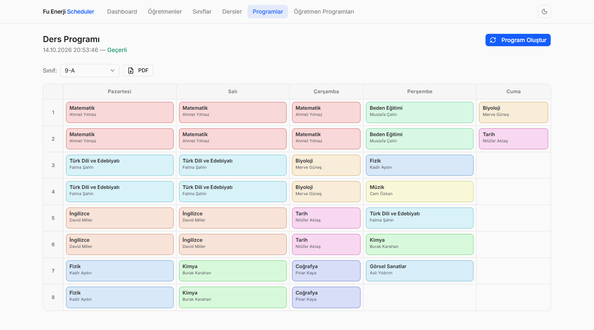
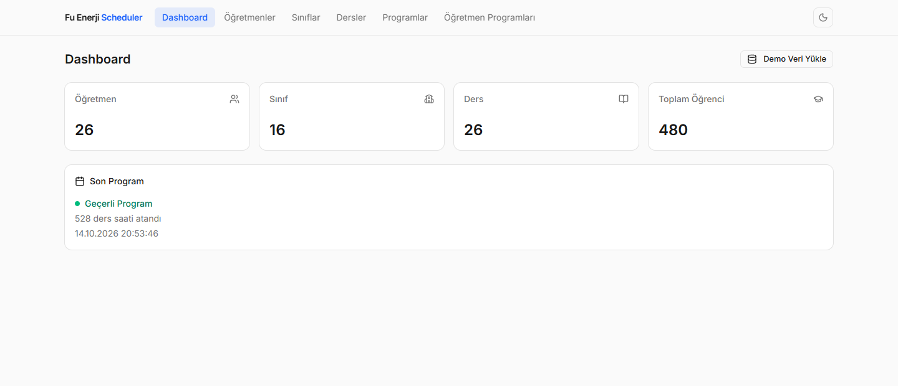
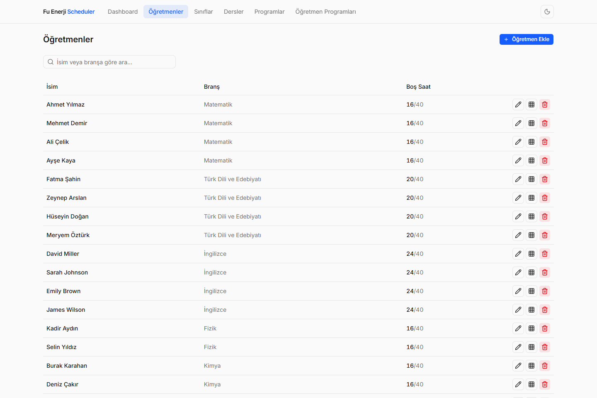
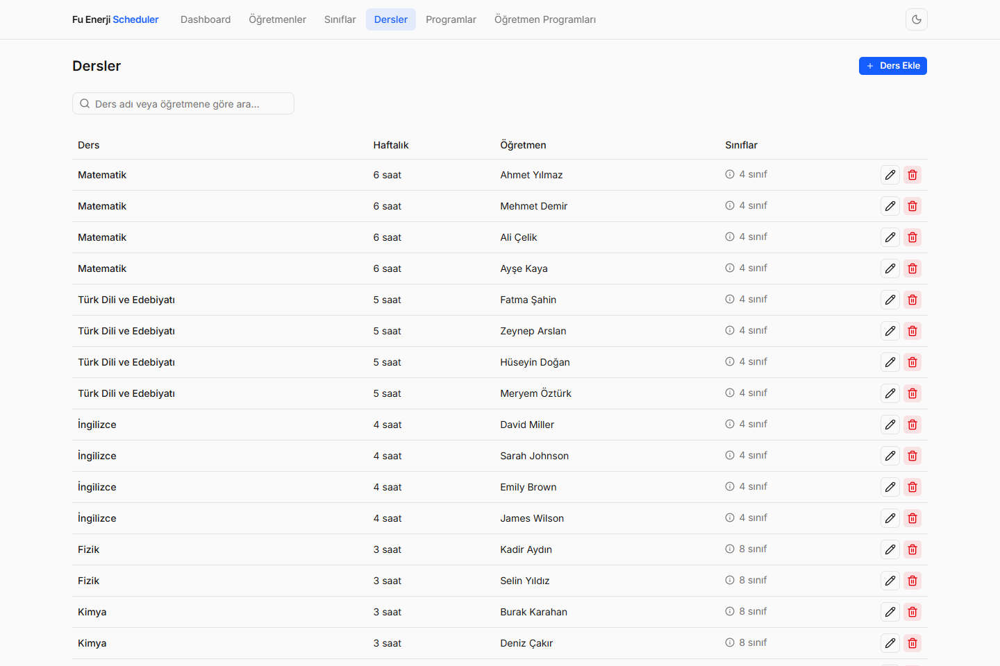
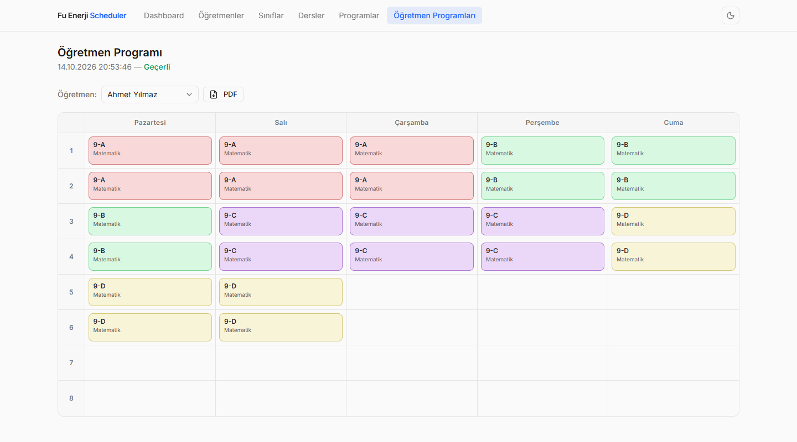
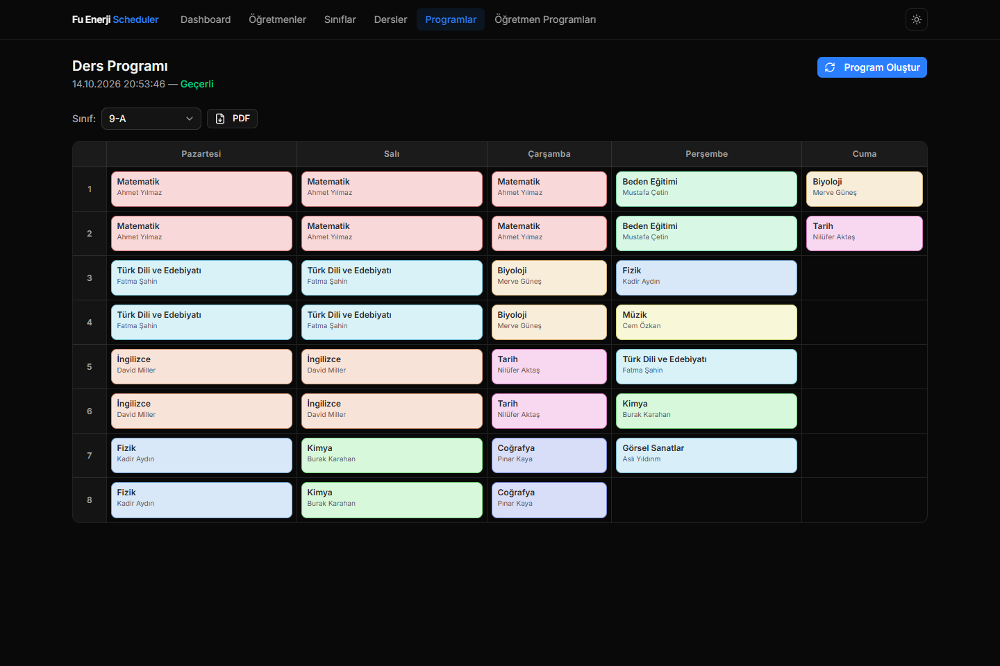

# Fu Enerji Scheduler

**[🇬🇧 English](README.md) · 🇹🇷 Türkçe**

[](frontend)
[](backend)
[](frontend)
[](backend)
[](LICENSE)
[](https://github.com/umitarslann9/fu-enerji-scheduler/actions/workflows/ci.yml)

Okul idarecileri için haftalık ders programı otomatik oluşturma uygulaması. Öğretmenleri (5 gün × 8 saatlik müsaitlik matrisiyle), sınıfları ve dersleri tanımlarsınız; sıfırdan yazılmış kısıt tatmin (CSP) çözücüsü her sınıf ve her öğretmen için çakışmasız bir haftalık çizelge üretir, renkli grid olarak gösterir ve PDF olarak indirir.

Fu Enerji işe alım case study'si olarak 3 günde geliştirildi: önde Next.js 16 + TypeScript, arkada FastAPI + SQLModel, ortada kara kutu içermeyen ve her kararı savunulabilen bir backtracking çözücü.



> **Durum:** Barındırılan backend (Railway ücretsiz plan) şu an kapalı; Vercel'deki frontend tek başına kullanılamıyor. Projeyi aşağıdaki iki komutla yerelde çalıştırın.

## Yerel Kurulum

**Backend** — Python 3.11+ ve [uv](https://docs.astral.sh/uv/):

```bash
cd backend
uv sync
uv run python main.py      # → http://localhost:8000   (Swagger UI: /docs)
```

**Frontend** — Node 20+:

```bash
cd frontend
npm install
npm run dev                # → http://localhost:3000
```

http://localhost:3000 adresini açıp **Dashboard → Demo Veri Yükle** butonuna basın (16 sınıf, 26 öğretmen, 26 ders, ~%82 doluluk; solver tamamını bir saniyenin altında yerleştirir), ardından **Programlar → Program Oluştur** ile solver'ı çalıştırın.

Ortam değişkenleri: frontend için `NEXT_PUBLIC_API_URL` (varsayılan `http://localhost:8000`), backend CORS listesi için `ALLOWED_ORIGINS` (varsayılan `http://localhost:3000`, bkz. `backend/.env.example`).

## Uygulama Sayfaları

| Sayfa | Açıklama |
|---|---|
| Dashboard | İstatistik kartları, son program durumu, Demo Veri Yükle butonu |
| Öğretmenler | CRUD · branş · izin durumu · 5×8 interaktif müsaitlik matrisi · boş saat sayacı |
| Sınıflar | CRUD · sınıf + şube + öğrenci sayısı (`9-A` gibi ad otomatik türetilir) |
| Dersler | CRUD · branş-öğretmen bidirectional sync · çoklu sınıf seçimi |
| Programlar | Sınıf bazlı haftalık grid · sınıf dropdown · PDF indirme |
| Öğretmen Programları | Öğretmen bazlı haftalık grid · öğretmen dropdown · PDF indirme |

Tüm liste sayfalarında aynı pattern: sağ üstte ekle butonu, collapsible form, anlık arama. Dark mode sistem temasını izler, navbar'dan değiştirilebilir.

## Ekran Görüntüleri

| Dashboard | Öğretmenler |
|---|---|
|  |  |

| Dersler | Öğretmen programı |
|---|---|
|  |  |



## Scheduler Algoritması (CSP + Backtracking)

Problem: Her `(Subject, Classroom)` çifti için haftalık saat kadar ders dilimi ata; hiçbir öğretmen veya sınıf aynı anda iki yerde olmasın, her öğretmen aldığı slotta müsait olsun.

```
1. Split    — haftalık saati günlük ardışık bloklara böl (max 2'li; haftaya yayılır)
               1h=[1]  2h=[2]  3h=[2,1]  4h=[2,2]  5h=[2,2,1]  6h=[2,2,2]

2. Expand   — (subject, classroom) × blok sayısı kadar BlockNeed üret

3. MRV sort — öğretmen müsaitlik sayısına göre artan sırala
               (en kısıtlı öğretmenden başla → erken hata, az backtrack)

4. Backtrack — geçerli slot yoksa bir önceki atamaya geri dön
               (3 milyon iterasyon limiti — sonsuz döngü koruması)

5. Spread   — teacher_day_load ile slot sırala → bloklar haftaya doğal yayılır
```

**Hard constraints:** öğretmen çakışması yok · sınıf çakışması yok · availability matrisi · blok içindeki periyotlar ardışık · aynı (ders, sınıf) bloğu aynı günde tekrar yok

**Bilinen sınırlar:** Çözüm yoksa solver "bulunamadı" der ama hangi bloğun atanamadığını söylemez; öğretmen tercihleri (soft constraint) modellenmemiştir. 25 tasarım kararının gerekçesi ve adım adım geliştirme günlüğü [ROADMAP.md](ROADMAP.md) dosyasında.

## Veri Modeli

- **Teacher → Subject:** 1-to-many (her ders tek öğretmen); `branch` alanı ders adını taşır
- **Classroom:** `grade` + `section` → `name` türetilir (`"9-A"`); `student_count` saklanır
- **Classroom ↔ Subject:** many-to-many (`ClassroomSubjectLink` association table)
- **Availability:** 5×8 boolean matrix, JSON string olarak DB'de saklanır
- **ScheduleResult:** Üretilen program `lessons_json` (JSON) olarak SQLite'ta kalıcı saklanır, `is_feasible` bayrağıyla

### Cascade Güncelleme Kuralları

Veriler değiştiğinde mevcut program otomatik güncellenir veya geçersiz işaretlenir. Tüm işlemler tek transaction içinde atomiktir.

| Tetikleyici | Etkilenen |
|---|---|
| Öğretmen branşı değişir | İlgili `Subject.name` kayıtları + `lessons_json` içindeki `subject_name` |
| Sınıf grade/section değişir | `Classroom.name` yeniden türetilir + `lessons_json` içindeki `classroom_name` |
| Ders adı değişir | `lessons_json` içindeki `subject_name` güncellenir |
| Dersin öğretmeni değişir | `lessons_json` güncellenir + `is_feasible = False` (yeni öğretmen eski slotlarda müsait olmayabilir) |
| Dersten sınıf çıkarılır | O sınıfa ait dersler `lessons_json`'dan silinir |
| Dersin haftalık saati değişir | `is_feasible = False` — yeniden oluşturma gerekir |
| Öğretmen izne ayrılır / döner | `is_feasible = False` — yeniden oluşturma gerekir |

## API Referansı

| Method | Yol | Açıklama |
|---|---|---|
| GET / POST | `/teachers` | Liste / ekle |
| GET / PUT / DELETE | `/teachers/{id}` | Tek kayıt / kısmi güncelle / sil (dersi varsa 409) |
| GET / POST | `/classrooms` | Liste / ekle |
| GET / PUT / DELETE | `/classrooms/{id}` | Tek kayıt / güncelle / sil |
| GET / POST | `/subjects` | Liste / ekle |
| GET / PUT / DELETE | `/subjects/{id}` | Tek kayıt / güncelle / sil |
| POST | `/schedule/generate` | Solver'ı çalıştır, sonucu DB'ye kaydet |
| GET | `/schedule` | Son üretilen programı döndür |
| POST | `/seed` | Demo veri yükle (mevcut veriyi sıfırlar) |
| GET | `/health` | Servis sağlık kontrolü |

İnteraktif dokümantasyon FastAPI tarafından `/docs` altında sunulur.

## Stack

| Katman | Teknoloji | Gerekçe |
|---|---|---|
| Frontend | Next.js 16 + TypeScript + Tailwind 4 + shadcn/ui | App Router, tipli API client, Vercel uyumu |
| Backend | FastAPI + SQLModel + SQLite | Pydantic validation, async, router → service → DB katmanlaması |
| Scheduler | CSP + Backtracking (sıfırdan yazıldı) | Kara kutu yok; her karar savunulabilir |
| Deploy (orijinal) | Vercel (frontend) + Railway (backend) | Vercel Python Functions kısıtlı; Railway persistent volume sunuyordu |

## Proje Yapısı

```
fu-enerji-scheduler/
├── frontend/
│   ├── app/
│   │   ├── page.tsx                # Dashboard
│   │   ├── providers.tsx           # next-themes ThemeProvider
│   │   ├── teachers/               # Öğretmen CRUD + müsaitlik matrisi
│   │   ├── classrooms/             # Sınıf CRUD
│   │   ├── subjects/               # Ders CRUD + branş-öğretmen sync
│   │   ├── schedule/               # Haftalık program grid (sınıf bazlı)
│   │   └── teacher-schedule/       # Haftalık program grid (öğretmen bazlı)
│   ├── components/
│   │   ├── nav.tsx                 # Navigasyon + dark mode toggle
│   │   └── availability-grid.tsx   # 5×8 interaktif müsaitlik matrisi
│   └── lib/
│       ├── api.ts                  # Typed fetch client
│       └── types.ts                # Backend şemalarına karşılık TypeScript tipleri
├── backend/
│   ├── main.py                     # uvicorn giriş noktası
│   ├── tests/
│   └── app/
│       ├── main.py                 # FastAPI app + CORS middleware
│       ├── db/database.py          # SQLite engine + idempotent migration
│       ├── models/schemas.py       # SQLModel tablo modelleri + Pydantic şemaları
│       ├── routers/                # teachers / classrooms / subjects / schedule / seed
│       ├── services/               # İş mantığı + cascade update katmanı
│       └── scheduler/solver.py     # CSP + Backtracking algoritması
├── docs/screenshots/
├── ROADMAP.md                      # Karar günlüğü + geliştirme günlüğü
└── LICENSE
```

## Tasarım Sistemi

- **Font:** Inter (400/500/600) — `next/font` ile yüklü, layout shift yok
- **Renkler:** zinc nötr skalası; blue-600 primary accent
- **Dark mode:** `next-themes` (`attribute="class"`); sistem teması destekli; navbar'da Sun/Moon toggle
- **Timetable renkleri:** golden-angle algoritması (`i × 137.5° mod 360°`) — 26 derste bile hiçbir iki renk çakışmaz

## Kapsam Dışı

Authentication · çoklu kullanıcı · oda/laboratuvar tahsisi · takvim export (.ics) · öğretmen tercihleri (soft constraint) · yedek öğretmen

## AI Kullanımı

Mimari kararlar, algoritma tasarımı, trade-off değerlendirmeleri → benim.
Claude Code: boilerplate üretimi, syntax, hata ayıklama, best practice kontrolü.

## Lisans

[MIT](LICENSE) © 2026 Ümit Arslan
